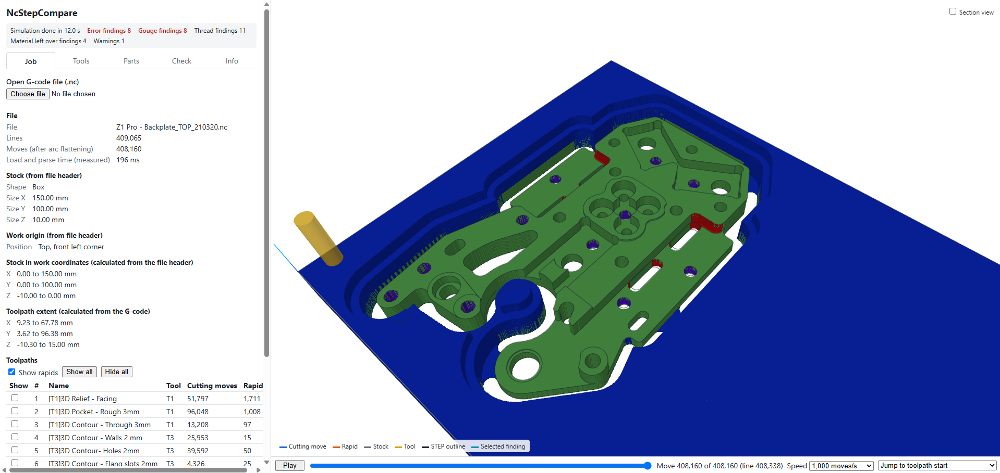

# NcStepCompare

Check a CNC job before you cut it. NcStepCompare simulates a 3-axis milling G-code file, compares the
machined result with your STEP model, and lists every gouge, every spot of leftover material and every
risky move.

**Open the app: https://ncstepcompare.jaak0b.at**

Everything runs in your browser. The G-code and STEP files are read locally and never uploaded.



## What it does

- **Simulates the material removal** on a 0.05 mm grid, including undercuts such as thread grooves from
  a thread mill's real tooth profile. Time slider and playback per toolpath.
- **Compares with the STEP model.** The machined stock is coloured by deviation: green within tolerance, red
  where the tool cut deeper than the model (gouge), blue where material is left over, purple for thread holes. Tolerances
  are editable.
- **Places the parts in the stock** by hand (centre, bottom, rotation, up axis) or with "Auto-orient",
  which tries all orientations and finds the best position.
- **Lists findings**, each clickable so the camera jumps to it:
  - gouges and leftover material, including holes that do not go through
  - rapid moves through material
  - shank or holder contact above the flute length
  - cuts into the spoilboard below the stock
  - cutting with the spindle off, a feed of 0, plunges at the cutting feed
  - width and depth of cut over the tool's limit, per toolpath
  - threads cut by a thread mill, reported as threads rather than gouges
- **Estimates the run time** per toolpath and in total, from the programmed feeds (acceleration is
  ignored).

## Supported input

- G-code: G0, G1, G2, G3 (G17 plane), G90/G91, G20/G21, tool changes (`T# M6`).
- Makera Studio files: stock, work origin, tools and toolpath names are read from the `;@MKR|` header.
  For other G-code, enter the tool table by hand.
- Tool shapes: flat end mill, ball end, drill, V-bit, thread mill.
- STEP files (AP203/AP214), one or more parts per job.

Tool table edits are saved in the browser and reused for any job with the same Makera Studio tool name.

## Limits

- 3-axis milling only. Files with rotary axis words (A, B or C on a motion line) are refused.
- Machine travel limits are not checked; the machine controller handles them.
- The spindle and collet nut are not checked for collisions.

## Run it locally

Requires Node.js 24.

```bash
npm install
npm run dev
```

Then open http://localhost:5173. Run the tests with `npm test`.

Built with Vue 3, Vite, TypeScript, three.js and occt-import-js (OpenCascade compiled to WebAssembly).
